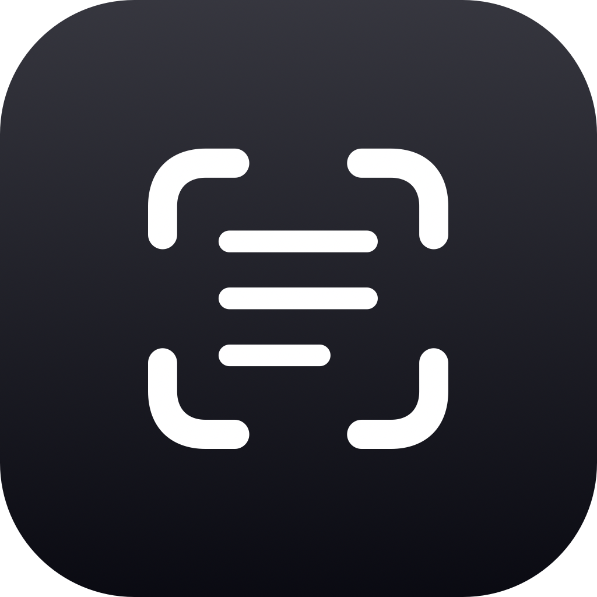

<div align="center">



# Glyph

**Grab text and QR codes from anywhere on your screen.**

A small, fully native macOS menu bar app. Press a shortcut, drag over anything,<br>
and the text is on your clipboard. No telemetry, no Electron, no account.

[](#requirements)
[](https://swift.org)
[](Resources/Info.plist)
[](LICENSE)

</div>

---

## Features

- **One shortcut, any pixel.** `⌘⇧2` opens the native macOS selection crosshair. Select a region and the result is copied.
- **QR codes and barcodes.** If the selection holds a code, Glyph copies its payload. Otherwise it reads the text.
- **On-device OCR.** Uses Apple's Vision framework. Nothing leaves your Mac.
- **Reads small text.** It picks up small glyphs like exponents, and retries without language correction so a lone letter or symbol isn't dropped.
- **Ready on the first capture.** The recognition model is warmed up at launch, so your first capture isn't slow.
- **Toast confirmation.** A small floating toast shows what was copied. Click it to expand the full text. It doesn't need notification permission.
- **Searchable history.** A Spotlight-style panel with your last 50 captures. Search with highlighted matches, click to re-copy, right-click to delete.
- **Liquid Glass.** Uses real Liquid Glass on macOS 26 and falls back to translucent materials on earlier versions.
- **Plays well with window managers.** Windows work with macOS's window tiling shortcuts and with Raycast, and Glyph never shows a Dock icon.

## Usage

| Action | How |
|---|---|
| Capture text / QR | `⌘⇧2` (customizable) or **Capture Text / QR** in the menu |
| Cancel a capture | `Esc` during selection. Nothing is copied. |
| Open history | **History…** in the menu |
| Re-copy a past capture | Click it in History |
| Open settings | **Settings…** (`⌘,`) in the menu |
| Close a Glyph window | `Esc` or `⌘W`. Windows also close on their own 5 seconds after you click away. |

When a capture succeeds you hear a soft *Glass* sound. If Glyph finds no text or code in the selection, you hear *Funk* and see a "No text or code found" toast, so it never fails silently.

## Settings

| Setting | Description |
|---|---|
| **Capture Shortcut** | Record any global shortcut. It needs ⌘, ⌥ or ⌃ (or a bare F-key). |
| **Language** | *Automatic* by default, or pin any language Vision supports |
| **Launch at Login** | Start Glyph when you log in |
| **Keep Line Breaks** | Join OCR lines with newlines (on) or spaces (off) |
| **Show Toast** | Show or hide the confirmation toast |
| **Clear Capture History** | Delete every saved capture, after a confirmation |

## Install

Glyph is a Swift Package Manager project. It doesn't use an `.xcodeproj`.

```bash
git clone https://github.com/filippocappa/glyph.git
cd glyph
./Scripts/build_app.sh
mv Glyph.app /Applications/
open /Applications/Glyph.app
```

`build_app.sh` builds a release binary and packages it into a signed `Glyph.app`. Glyph needs a real bundle for `LSUIElement` (no Dock icon) and Launch at Login to work.

> [!IMPORTANT]
> On your first capture, macOS asks for **Screen Recording** permission. Grant it in **System Settings → Privacy & Security → Screen & System Audio Recording**.

> [!TIP]
> The script signs with your **Apple Development** identity if it finds one, and falls back to ad-hoc signing otherwise. With ad-hoc signing, macOS treats every rebuild as a new app and asks for Screen Recording permission again. To avoid that, sign into your Apple ID once in **Xcode → Settings → Accounts**.

### Requirements

- macOS 14 Sonoma or later (Liquid Glass on macOS 26)
- Xcode 16+ / Swift 6 toolchain

For a quick debug build without packaging, run `swift build`. Some features, like Launch at Login, only work from the `.app` bundle.

## How it works

```
⌘⇧2 ──▶ screencapture -i -x ──▶ Vision ──▶ clipboard + history + toast
                                  │
                                  ├─ VNDetectBarcodesRequest  → payload wins if found
                                  └─ VNRecognizeTextRequest   → .accurate, sorted into reading order
                                       └─ retry without language correction if empty
```

1. **Capture.** Glyph runs the system's own `screencapture -i -x` and reads the PNG it writes to a temp file, then deletes the file. If you press Esc, no file is written and nothing happens.
2. **Recognize.** Barcode detection and OCR run in a single Vision pass. A barcode payload takes priority. Text lines are sorted top-to-bottom and left-to-right, because Vision doesn't return them in reading order.
3. **Deliver.** The result goes to the clipboard and into history, which is a small JSON blob in `UserDefaults`. Then Glyph plays the sound and shows the toast.

## Project structure

| File | Responsibility |
|---|---|
| `main.swift` | Entry point. Forces the `.accessory` activation policy (no Dock icon). |
| `AppDelegate.swift` | Lifecycle, global hotkey, Vision warm-up, hidden main menu for `⌘W` / `⌘C` / `⌘V`, reopen handling |
| `MenuBarController.swift` | Status item, menu, capture pipeline, clipboard and sound feedback |
| `CaptureManager.swift` | Runs `/usr/sbin/screencapture` and loads the result as a `CGImage` |
| `VisionProcessor.swift` | Barcode detection, OCR, reading-order sorting, fallback pass |
| `HistoryStore.swift` | Capped (50), persisted capture log |
| `HistoryView.swift` · `HistoryWindowController.swift` | Spotlight-style History panel |
| `SettingsView.swift` · `SettingsWindowController.swift` | Settings window |
| `ShortcutRecorderView.swift` | Custom global shortcut recorder |
| `ToastController.swift` · `ToastView.swift` | Floating, expandable confirmation toast |
| `AppWindow.swift` | `GlyphWindow`, which window managers can see, and activation helpers |
| `GlassEffects.swift` | Liquid Glass and visual-effect helpers with pre-macOS 26 fallbacks |
| `SettingsKeys.swift` · `KeyboardShortcuts+Name.swift` | `UserDefaults` keys and the default shortcut |

Scripts:

- `Scripts/build_app.sh` builds, bundles and signs `Glyph.app`.
- `Scripts/generate_icon.swift` renders `Resources/AppIcon.iconset`. Convert it with `iconutil -c icns Resources/AppIcon.iconset`.

## Dependencies

- [KeyboardShortcuts](https://github.com/sindresorhus/KeyboardShortcuts) for global hotkey registration
- [LaunchAtLogin](https://github.com/sindresorhus/LaunchAtLogin) for the login item

Everything else is Apple frameworks: AppKit, SwiftUI and Vision.

## License

[MIT](LICENSE) © 2026 Filippo Cappa
